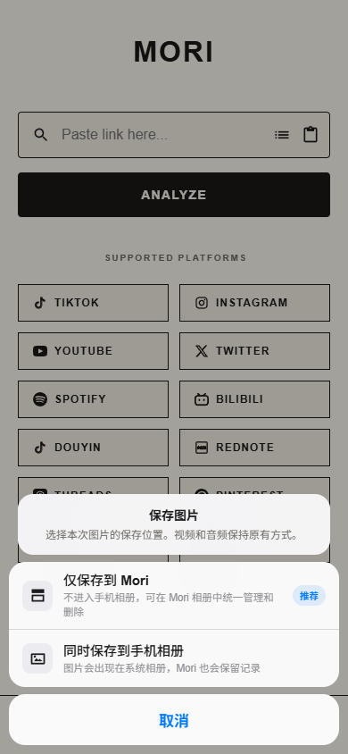
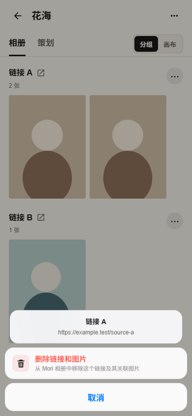
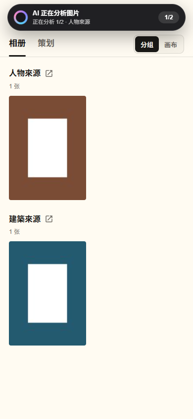
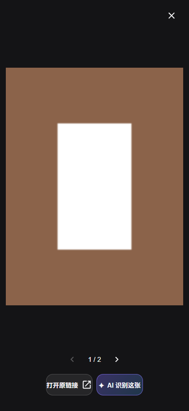
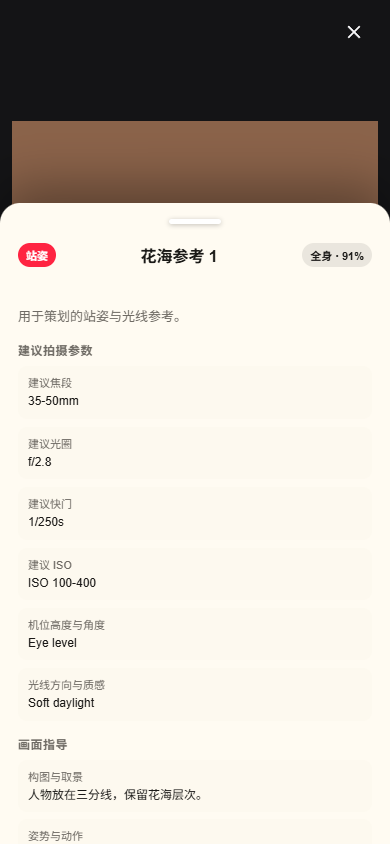
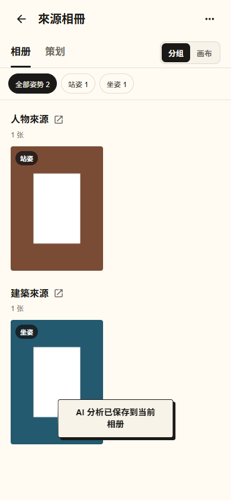
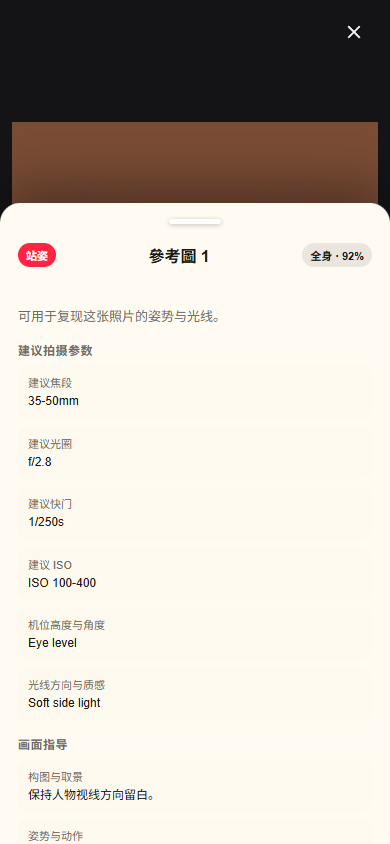
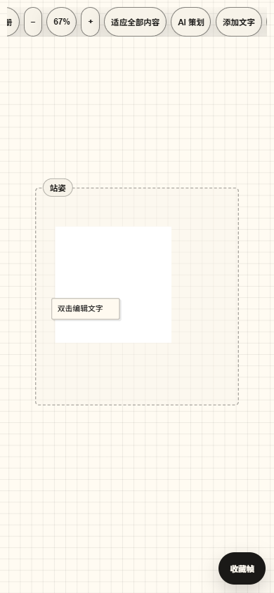
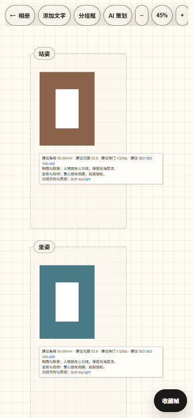
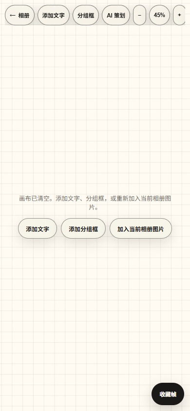

# Mori Android AI Edition

[](https://github.com/EonGreen0/Mori-Android-AI/actions/workflows/android.yml)
[](LICENSE)

基于 [coflyn/Mori](https://github.com/coflyn/Mori) 的 Android AI 个人修改版。项目在原有媒体下载、灵感相册和策划画布基础上，增加了用户自备多模态 AI、逐图姿势分析、摄影建议、相册内分类、手机策划缩放和 AI 策划排版。

> This is an unofficial derivative. The Android AI edition is developed by [EonGreen0](https://github.com/EonGreen0) and is not affiliated with the upstream author.

当前版本：**4.9.7**

## 功能

### 媒体解析与下载

- 支持上游现有的多个平台解析入口，包括抖音、Bilibili、TikTok、Instagram、YouTube、Twitter/X、Pinterest、Threads、Pixiv、Bandcamp 等。
- 小红书使用可直接维护的短链跳转与 SSR 解析器，保留 `xsec_token`，支持图文、视频和备用媒体地址。
- Android 下载保存、批量链接、历史记录、PDF 导出和媒体预览沿用 Mori 原有能力。

### 本地相册

- 从 Android 系统相册多选导入图片。
- 图片复制到 App 私有目录，后续可离线查看。
- 创建相册，并把多个来源链接手动加入同一个相册。
- 在解析结果页选择现有相册或直接新建相册。
- 下载图片时可选“仅保存到 Mori”或“同时保存到手机相册”；默认推荐 Mori 私有缓存，避免链接素材挤占系统相册。
- 相册内每个来源链接都有独立操作菜单，可删除链接及关联图片；系统相册副本无权限删除时，会提示手动清理。
- 单击图片进入全屏预览后可左右滑动切换上一张和下一张；底部“打开原链接”旁可直接对当前图片执行 AI 识别。
- 长按相册封面可重命名、合并到其他相册或删除归类；删除不会删除原图片。
- 支持本地相册包 `.mori-album` 导入。

<p align="center">
  
  
</p>

### AI 图片分析与姿势分类

- 支持用户填写的 OpenAI-compatible 多模态 API。
- API Key 由 Android Keystore AES-GCM 加密，不进入 `localStorage`。
- Key 与保存时授权的 HTTPS 域名绑定，原生桥拒绝请求到其他主机。
- 支持简体中文、繁体中文和英语 AI 输出。
- 逐图识别站姿、坐姿、蹲姿、跪姿、躺姿、行走、跑步、跳跃、倚靠、互动等姿势。
- 为每张图片生成景别、构图、动作建议、后期方向和建议摄影参数。
- 建议参数包括等效焦段、光圈、快门、ISO、机位高度与角度、光线方向和质量。
- 分析结果保存在 IndexedDB，并按图片哈希、模型、语言和提示版本缓存。

AI 分类保留在用户原有相册内部。例如“花海拍摄”仍是主相册，姿势分类以筛选标签显示，不会生成一堆割裂的顶层相册。

<p align="center">
  
</p>

<p align="center">
  
  
</p>

<p align="center">
  
  
  
</p>

### 手机策划

- 本地相册可自动创建可编辑策划。
- 双指捏合缩放，单指拖动空白区域平移。
- 提供缩放减号、百分比复位、缩放加号和适应全部按钮。
- 支持文字、分组框、清空、图片移动、缩放、旋转、连线与删除。
- AI 策划会复用已有图片分析，按姿势创建分组框并执行三列画布排版。
- AI 排版保留用户文字和备注；再次执行只替换之前的 AI 分组框。
- AI 策划复用相册单图识别结果，按姿势分组，并把焦段、光圈、快门、ISO、构图、动作和光线建议整理成组内拍摄摘要。
- 单张图片已识别后不会在策划页重复请求模型；策划只补充尚未分析的图片。
- 在只读云端策划上执行 AI 策划时，会先创建可编辑的本地副本并明确提示。
- AI 逐张分析期间会显示持续进度通知；Android 16 和支持实时通知的设备可在顶部显示当前张数、总数和文件名。OPPO 等厂商是否提升为流体云样式由系统控制。

<p align="center">
  
  
</p>

### 同步

- 保留原有可选 Cloudflare Worker、D1 和 R2 同步代码。
- 本地相册、AI 分析和策划不依赖云服务。
- 本项目不会附带个人同步密钥、登录状态或用户素材。

## 安装

请优先从本仓库的 **Releases** 页面下载 APK。仓库本身不提交 APK 或签名密钥。

Android 要求：

- Android 7.0 或更高版本。
- 安装体验包时允许“安装未知应用”。
- 若与已安装 Mori 的签名不同，不要直接覆盖；先备份重要相册与策划。

## 配置 AI

1. 打开 **设置 → 通用 → AI 整理**。
2. 填写 OpenAI-compatible Base URL，例如 `https://api.openai.com/v1`。
3. 填写支持图片输入的模型 ID。
4. 粘贴 API Key 并保存。
5. 选择 AI 输出语言：简体中文、繁体中文或英语。
6. 点击“测试连接”。

请求格式：

- HTTPS，端口 443。
- `Authorization: Bearer <API key>`。
- OpenAI Chat Completions 消息格式。
- 模型需接受 `text` 和 `image_url` 内容片段。

详细实现与安全边界见 [docs/AI_ORGANIZER.md](docs/AI_ORGANIZER.md)。

## 从源码构建

### 环境

- Node.js 24 或兼容版本
- JDK 21
- Android SDK 36
- Android Build Tools 36.0.0
- 可选 NDK 28.2.13676358
- Windows 桌面端额外需要 Rust、MSVC 和 Windows SDK

### Android

```powershell
npm ci

$env:JAVA_HOME = "C:\path\to\jdk-21"
$env:ANDROID_HOME = "C:\path\to\android-sdk"
$env:ANDROID_SDK_ROOT = $env:ANDROID_HOME

npm run build:android
```

Debug APK 输出：

```text
android/app/build/outputs/apk/debug/Mori v4.9.7.apk
```

Release 构建需要在项目外配置：

```text
%USERPROFILE%\.mori\android-signing.properties
```

签名密钥、密码、同步令牌和 AI Key 均不应提交到 Git。

### Windows

```powershell
npm ci
npm run tauri:build -- --bundles nsis
```

## 开发与测试

```powershell
npm start
npm test
```

测试覆盖：

- 策划同步、冲突合并和 Tombstone；
- 本地相册包导入与安全回滚；
- 图库多选导入；
- 链接手动加入相册；
- AI 配置、Keystore 桥、缓存、姿势分类和摄影参数；
- 手机双指缩放和 AI 策划排版；
- 小红书短链、SSR、视频备用地址和 OpenGraph 回退。

## 项目结构

```text
public/                共享 HTML、CSS、JavaScript UI
  js/modules/          AI、相册、策划和设置模块
  js/sync/             Planner 同步与远端合并
  js/scrapers/         可维护的解析器入口
android/               Capacitor Android 工程
src-tauri/             Tauri Windows/Rust 工程
cloudflare/            可选 Worker、D1、R2 同步端
scripts/               本地开发、验证与 Android 构建脚本
docs/                  AI、策划和依赖说明
```

更多文档：

- [Android 策划缩放与 AI 排版](docs/PLANNER_MOBILE.md)
- [AI 图片分析](docs/AI_ORGANIZER.md)
- [小红书解析](docs/REDNOTE.md)
- [外部二进制依赖](docs/EXTERNAL_DEPENDENCIES.md)

## 已知限制

- 摄影参数是根据画面生成的重现建议，不是照片原始 EXIF。
- AI 功能需要联网，实际效果取决于用户配置的模型。
- 小红书可能返回安全验证页；本项目不会绕过验证码或登录限制。
- `scrapers.bin`、`morisec.obj` 和 `libmorisec` 为预编译依赖，仓库不能重新生成其内部实现。
- 各平台接口会变化，解析功能不能保证永久可用。
- 本项目仍需针对真实模型、真实设备和各平台链接持续做兼容测试。

## 隐私与安全

- AI API Key 只保存在 Android Keystore。
- AI 请求只发送压缩预览，不发送云端同步密钥。
- 相册包、历史记录和策划数据不会自动上传。
- 使用第三方 AI 服务时，图片预览会发送到用户配置的服务商；请自行确认服务商的数据政策。
- 不要在公开 Issue 中粘贴 API Key、同步密钥、私人作品链接或用户数据。

## 许可证与上游

本项目沿用上游的 **GNU GPL v3.0 or later** 许可证，详见 [LICENSE](LICENSE)。

- Android AI edition: [EonGreen0](https://github.com/EonGreen0)
- Upstream open-source project: [coflyn/Mori](https://github.com/coflyn/Mori)

上游名称、Logo 和身份仍归原作者所有。本仓库是个人修改版，不代表上游官方发布。
